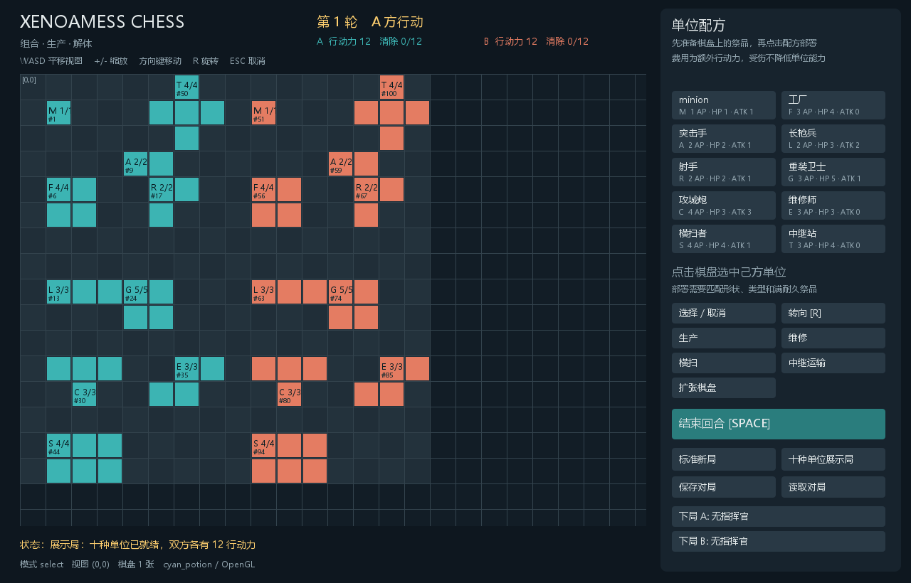

# xenoamess_chess demo

基于 cyan_potion 的本地双人回合制棋类 demo，包含十种基础单位、形状组合、累计耐久、递归解体、生产、维修、中继运输、多棋盘扩张、三种指挥官与存档读档。

界面、MCP 和测试使用同一套规则。图形窗口通过引擎的 `GameManager`、组件树、输入事件、`Texture` 和 `Picture` 运行，没有另开替代引擎的网页或 Swing 游戏窗口。



设计文档见 [设计总览](docs/design/README.md)、[核心规则](docs/design/rules.md) 和 [基础阵营的 10 种单位](docs/design/units.md)。

## 构建与运行

需要 JDK 17 或 21、Maven、PowerShell。MCP 启动器和端到端测试还需要 Node.js 20+，不需要安装 npm 依赖。在仓库根目录执行：

```powershell
./scripts/build-chess.ps1
./scripts/run-chess.ps1
```

也可运行 `./scripts/run-chess.ps1 -Build`，先构建再启动。构建脚本执行 MCP、chess 规则和控制器的相关测试，并准备运行依赖。

默认标准局提供双方的起始工厂与 minion。“十种单位展示局”提供双方完整十种单位及各 12 点行动力，便于尝试能力。

## 操作

| 操作 | 使用方法 |
| --- | --- |
| 选择 | 点击当前玩家的单位；右键或 ESC 取消 |
| 移动 | 方向键移动一格；点击与选中格同一行／列的位置，可执行突击手冲刺 |
| 普通攻击 | 选中单位后点击敌军；或以有近战能力的单位接敌移动 |
| 部署／组合 | 点击右侧配方，再点击目标形状左上角；祭品须在原位置完整匹配 |
| 转向 | 部署时 R 旋转配方；选中多格单位后 R 围绕选中格转向，占整次行动 |
| 生产 | 选中工厂 → 生产 → 工厂旁的空格 |
| 维修 | 选中维修师 → 维修 → 相邻友军 |
| 横扫 | 选中横扫者 → 横扫 → 三格长边外侧 |
| 中继 | 选中来源站 → 中继运输 → 货物 → 接收站 → 目的地形状左上角 |
| 扩张 | 扩张棋盘 → 未开放的相邻区块，消耗 3 点行动力 |
| 视图 | WASD 平移，+/- 缩放，支持负坐标棋盘 |
| 回合 | 空格、回车或“结束回合”按钮 |
| 指挥官 | 切换“下局 A/B”，然后开始新局 |
| 存档 | 保存／读取按钮使用 quick 槽；MCP 可以使用不同名称的槽 |

新部署、生产和解体得到的单位等待下个己方回合；耐久大于 0 时全部功能保持完整。临时胜利条件为清除 12 个基础组件；30 轮结束时按清除分比较。

## MCP 接入

游戏启动后，会话写入 `target/automation-session.json`，关闭时清理。会话、存档与测试截图都位于 Git 忽略的 `target` 中。

仓库 `.codex/config.toml` 已配置 `cyan_potion` MCP，启动器为 `node scripts/mcp-engine.mjs`。在仓库根目录打开受信任项目并重新加载 MCP 配置即可发现工具；已有会话也能使用下面的 MCP 客户端：

```powershell
node scripts/mcp-client.mjs engine_status
node scripts/mcp-client.mjs engine_commands
node scripts/mcp-client.mjs engine_screenshot '{}' src/xenoamess_chess/target/current.png
```

适配器可以在游戏启动前完成初始化与工具发现，读取状态和执行命令时游戏必须运行。适配器的协议输出与游戏日志分开。

JavaScript 可以保持连接并连续调用真实 MCP：

```javascript
import { EngineMcpClient } from './scripts/mcp-client.mjs';
const client = new EngineMcpClient();
try {
  await client.initialize();
  const state = await client.state();
  const factory = state.game.units.find(u => u.kind === 'FACTORY' && u.owner === state.game.player);
  await client.command('produce', {unitId: factory.id, x: 2, y: 5});
  await client.screenshot('src/xenoamess_chess/target/after-production.png');
} finally {
  client.close();
}
```

生产示例使用标准局 A 方初始工厂。通用模块见 [engine-mcp](../engine-mcp/README.md)，架构与验证记录见[自动化说明](docs/automation/README.md)。

## 回归测试

```powershell
./scripts/build-chess.ps1
node scripts/chess-smoke.mjs --headless
node scripts/chess-smoke.mjs
```

最后一条启动真实引擎窗口，用 MCP 操作、截图并完成一局，再关闭测试进程。两种模式分别在 `target/automation-artifacts/headless/` 和 `target/automation-artifacts/native/` 中生成报告、日志和四张截图。

无窗口画面明确标记 `HEADLESS`，不能替代原生验证。GitHub 专项工作流运行相关测试及无窗口 MCP 回归；原生验证在支持 OpenGL 的桌面运行。

当前是功能 demo，未实现联网、AI 或最终平衡。地图采用按需开放的区块集合；实现使用整数坐标，扩张坐标限制在 ±1,000,000 区块内。
