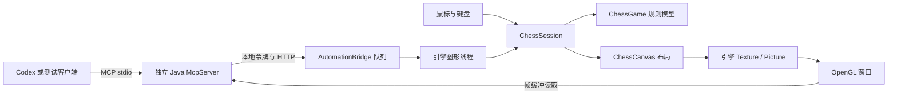

# 自动化接入与验证

## 结构

`src/engine-mcp` 不依赖 chess 或 GLFW。其他游戏实现 `AutomationTarget`，在自己的状态拥有者线程调用 `drain()`，即可接入相同工具。chess 的输入事件先进入队列，由图形线程处理；HTTP 工作线程不会直接修改游戏对象或访问 OpenGL。

状态包含规则和界面信息：运行模式、玩家、行动力、耐久、组件树、地图区块、选中单位、操作模式及每个按钮的逻辑坐标。

## 命令约定

`engine_commands` 是命令、参数 schema 与 required 字段的权威入口。目前提供 16 个命令：

| 分组 | 命令 |
| --- | --- |
| 对局 | `new_game`、`end_turn`、`resign` |
| 部署与空间 | `deploy`、`move`、`rotate`、`expand` |
| 战斗与支援 | `attack`、`produce`、`repair`、`sweep`、`teleport` |
| 保存 | `save`、`load` |
| 界面 | `ui_click`、`ui_key` |

界面坐标使用逻辑窗口 1280 × 820，而非截图的实际尺寸。通过 `ui.camera` 可转换世界格为逻辑坐标：`screenX + (worldX - cameraX + 0.5) * cellSize`，y 同理。也可以按 `ui.controls` 中的 controlId 点击按钮。

失败的规则命令不会消耗行动力或单位行动，也不会部分移动或部分消费祭品。界面可显示失败原因。存档槽只接受字母、数字、短横线和下划线，不能指定任意文件路径。

## 验证层次

| 层次 | 覆盖 |
| --- | --- |
| `McpServerTest`：2 项 | 初始化、通知、错误、工具发现、真实本地 HTTP、线程队列、事件及鉴权 |
| `ChessGameTest`：14 项 | 等待、伤害累计、完整功能、配方旋转、递归解体、射线、范围去重、维修、运输、胜负和存档校验 |
| `ChessSessionTest`：5 项 | 像素点击、按钮、键盘、参数、存档槽及 PNG |
| MCP 进程回归：每种模式 19 项 | 独立适配器与游戏进程之间的发现、界面操作、十种单位交互、保存、截图和完整对局 |

MCP 回归没有直接写入模型来制造结果。展示局是界面可选择的真实开局；后续移动、组合、伤害、维修、生产和运输全部走正常规则。

原生截图读取 GLFW 窗口的 OpenGL 帧缓冲；无窗口截图来自同一布局的离屏图像，并在画面和状态中标注运行模式。

## 已完成的验证

2026-11-04，在当前 Windows 桌面、JDK 21 环境中：

- 21 项相关单元／集成测试通过。
- 19 项无窗口 MCP 回归通过。
- 19 项真实窗口 MCP 回归通过。
- 已查看真实窗口的十种单位截图，确认棋盘、形状、耐久及操作面板正常显示。

原始报告保存在 `target/automation-artifacts`，不进入 Git。这些结果不等同于全仓库测试通过，也不表示已在所有操作系统和显卡上完成原生验证。

## 持续维护

1. 新规则在 `ChessGame` 实现，界面与 MCP 共用它。
2. 新增操作时同步维护 `ChessSession.commands()` schema、界面和测试。
3. 对规则边界补充规则测试，对跨进程交互扩展 MCP 回归。
4. 图形、字体、布局或渲染路径变化后，重新运行原生回归并查看截图。
5. 更新验证记录后，按仓库 `AGENTS.md` 提交并推送。

当前明确使用 [2025-11-25 stdio 协议](https://modelcontextprotocol.io/specification/2025-11-25/basic/transports)。项目配置依据 [OpenAI 官方 MCP 文档](https://developers.openai.com/codex/mcp)。升级协议或启动方式时，重新验证真实进程的握手、通知、发现及中文编码。
